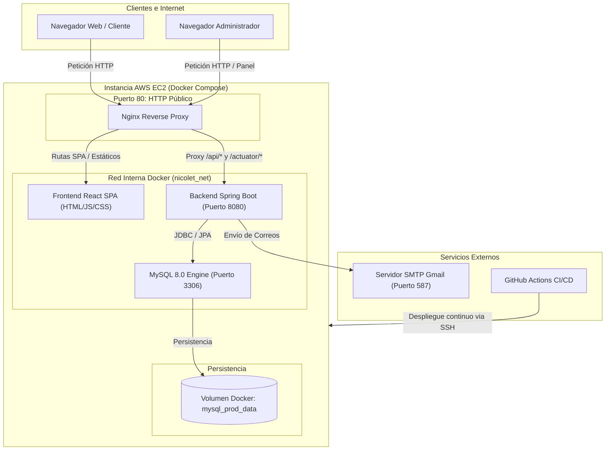
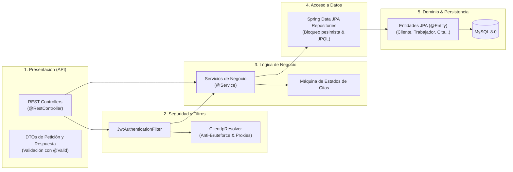
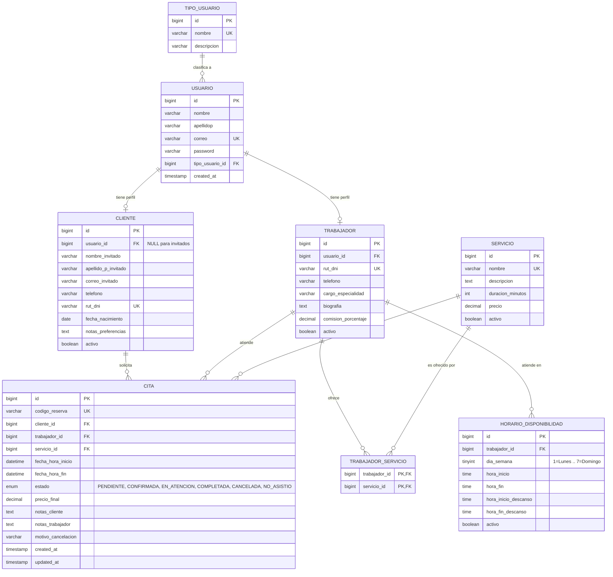

# Nicolet Estudio: Belleza a tu ritmo y sin barreras

Sistema web integral para la gestión y agendamiento de citas de estética y salón de belleza. La plataforma separa completamente la interfaz de usuario (SPA en React) del backend de lógica de negocio (API RESTful en Spring Boot 3), utilizando MySQL 8 como motor de base de datos relacional y Nginx como proxy inverso.

---

## Tabla de Contenidos

1. [Descripción del Proyecto](#descripción-del-proyecto)
2. [Tecnologías Utilizadas](#tecnologías-utilizadas)
3. [Arquitectura del Sistema](#arquitectura-del-sistema)
   - [Tipo de Arquitectura](#tipo-de-arquitectura)
   - [Mapa de Arquitectura](#mapa-de-arquitectura)
   - [Modelo de Capas (Layered Architecture)](#modelo-de-capas-layered-architecture)
4. [Base de Datos](#base-de-datos)
   - [Tipo de Base de Datos](#tipo-de-base-de-datos)
   - [Mapa Entidad-Relación (Diagrama ER)](#mapa-entidad-relación-diagrama-er)
5. [Despliegue en AWS EC2](#despliegue-en-aws-ec2)
   - [Arranque Automático "A la primera" (User Data)](#arranque-automático-a-la-primera-user-data)
   - [Manejo de IP Dinámica y AWS Academy](#manejo-de-ip-dinámica-y-aws-academy)
   - [Despliegue Continuo (CI/CD) con GitHub Actions](#despliegue-continuo-cicd-con-github-actions)
   - [Variables de Entorno en Producción](#variables-de-entorno-en-producción)
6. [Inicio en Local](#inicio-en-local)
   - [Inicio Rápido en Windows](#inicio-rápido-en-windows)
   - [Inicio Rápido en Linux](#inicio-rápido-en-linux)
   - [Ejecución Manual por Componentes](#ejecución-manual-por-componentes)
   - [Despliegue Local con Docker Compose](#despliegue-local-con-docker-compose)
7. [API y Documentación](#api-y-documentación)
   - [Swagger UI](#swagger-ui)
   - [Contratos y Reglas de Negocio](#contratos-y-reglas-de-negocio)
8. [Pruebas y Verificaciones](#pruebas-y-verificaciones)

---

## Descripción del Proyecto

Nicolet Estudio resuelve la problemática de reserva y coordinación de servicios estéticos, ofreciendo flujos diferenciados según el rol del usuario:

- **Clientes (Registrados o Invitados):** Exploración del catálogo de servicios, selección de especialistas, visualización de disponibilidad de agenda en tiempo real y reserva de citas con validación de conflictos.
- **Profesionales / Especialistas:** Consulta de su agenda de atención, control de estados de las citas asignadas y configuración de turnos laborales y descansos.
- **Administradores:** Panel de control centralizado para la administración de usuarios, asignación de roles, gestión de tarifas y catálogo de servicios, auditoría de citas, métricas de atención y diagnóstico del sistema.

Incluye notificaciones automáticas por correo electrónico vía SMTP y control de concurrencia mediante bloqueo de recursos para evitar la sobre-reserva simultánea de un mismo profesional.

---

## Tecnologías Utilizadas

| Capa / Área | Tecnología | Versión / Detalle |
|---|---|---|
| **Frontend** | React | 18 (SPA basada en hooks y contextos funcionales) |
| | Vite | 4.x / 5.x (Empaquetador y dev server ultrarrápido) |
| | React Router DOM | Enrutamiento declarativo del lado del cliente |
| | Lucide React | Iconografía modular y accesible |
| | Vitest & Testing Library | Suite de pruebas unitarias y de renderizado |
| **Backend** | Java | 17 LTS |
| | Spring Boot | 3.2.5 |
| | Spring Security | 6.x (Autenticación sin estado mediante tokens JWT) |
| | Spring Data JPA / Hibernate | Mapeo objeto-relacional y consultas optimizadas |
| | Spring Boot Starter Mail | Notificaciones SMTP con JavaMail |
| | Springdoc OpenAPI | Documentación Swagger UI integrada (OpenAPI 3) |
| | JUnit 5 & Mockito | Pruebas unitarias y de integración con BD H2 en memoria |
| **Base de Datos** | MySQL | 8.0 (Motor InnoDB, codificación `utf8mb4_unicode_ci`) |
| **DevOps / Infra** | Docker & Docker Compose | Contenerización multi-servicio |
| | Nginx | 1.25+ (Proxy inverso y servidor web estático) |
| | AWS EC2 | Computación en la nube (Ubuntu 22.04 / 24.04 o Amazon Linux 2023) |
| | Systemd | Orquestación de servicio local en la instancia EC2 |
| | GitHub Actions | Canalización CI/CD automatizada |
| | Cloudflare Tunnel | Túnel seguro para demostraciones públicas sin abrir puertos |

---

## Arquitectura del Sistema

### Tipo de Arquitectura

El sistema implementa una **Arquitectura Cliente-Servidor Desacoplada (Decoupled Client-Server / Modular Web Monolith)**:

1. **Frontend Desacoplado (SPA):** La interfaz de React se ejecuta enteramente en el navegador del cliente. No hay renderizado en servidor (SSR), lo que alivia el consumo de recursos de la API.
2. **Backend Stateless (API RESTful):** Spring Boot expone servicios HTTP REST bajo la convención `/api/v2/nicolet/*`. La autenticación se valida en cada petición mediante tokens JWT firmados (HMAC-SHA256/384).
3. **Proxy Inverso Unificado (Nginx):** Actúa como único punto de entrada en el puerto 80. Sirve los archivos estáticos de la SPA, despacha las rutas del navegador (`try_files`), reenvía peticiones API al backend preservando encabezados de cliente (`X-Forwarded-For`), e intercepta sondas de salud.

### Mapa de Arquitectura



### Modelo de Capas (Layered Architecture)

El backend de Spring Boot aplica una arquitectura en capas con responsabilidades bien delimitadas:



1. **Capa de Controladores (`controller`):** Exponen los endpoints REST, definen los códigos de estado HTTP y aplican validaciones declarativas mediante Jakarta Validation (`@NotNull`, `@Size`, `@Email`).
2. **Capa de Seguridad (`security`):** Extrae y valida tokens JWT, resuelve la IP real del cliente considerando los proxies de confianza configurados (`TRUSTED_PROXIES`), y limita intentos de inicio de sesión por dirección IP.
3. **Capa de Negocio (`service`):** Valida la disponibilidad horaria del profesional, verifica que el profesional atienda el servicio seleccionado, asegura la transición legal de estados de las citas y gestiona notificaciones por email.
4. **Capa de Acceso a Datos (`repository`):** Extiende `JpaRepository`, permitiendo consultas automáticas por firma de método y consultas JPQL con bloqueos explícitos para serializar reservas concurrentes.
5. **Capa de Dominio (`model`):** Clases entidad que mapean las tablas de MySQL mediante anotaciones Hibernate (`@Table`, `@ManyToOne`, `@JoinColumn`).

---

## Base de Datos

### Tipo de Base de Datos

- **Motor:** **MySQL 8.0 Relacional (RDBMS)**.
- **Motor de Almacenamiento:** **InnoDB** (soporte total de transacciones ACID, claves foráneas e integridad referencial).
- **Juego de Caracteres y Colación:** `utf8mb4` con `utf8mb4_unicode_ci` (compatibilidad universal con tildes en español, caracteres especiales y emojis).

### Mapa Entidad-Relación (Diagrama ER)



---

## Despliegue en AWS EC2

El proyecto cuenta con un sistema de aprovisionamiento automatizado diseñado para instancias EC2 (como `t2.micro` o `t3.micro` con 1 GB de RAM).

### Arranque Automático "A la primera" (User Data)

Al crear una nueva instancia en la consola de AWS EC2 (con Ubuntu 22.04/24.04 o Amazon Linux 2023), ve a **Advanced details > User data** y pega el siguiente script de una sola línea:

```bash
#!/bin/bash
curl -fsSL --retry 5 --retry-connrefused https://raw.githubusercontent.com/Felipex360x/Agendamiento-Cita-Main/main/scripts/ec2-bootstrap.sh | bash
```

#### ¿Qué realiza este script de manera 100% desatendida?
1. **Instalación de Software:** Instala Docker, Docker Compose y Git de forma nativa.
2. **Memoria Swap (2 GB):** Configura y activa swap automáticamente si la máquina cuenta con menos de 2 GB de RAM, impidiendo que el compilador de Java o Node caiga por falta de memoria (OOM).
3. **Clonado del Repositorio:** Descarga el código en `~/app` configurando los permisos para el usuario del sistema (`ubuntu` o `ec2-user`).
4. **Generación de Secretos Seguros (`.env`):** Si no existe un `.env`, genera claves aleatorias criptográficas para MySQL, JWT y Administrador. Si la máquina ya tenía una base de datos previa, preserva las contraseñas para mantener compatibilidad.
5. **Servicio Systemd `nicolet.service`:** Registra y habilita un servicio en el sistema operativo para que la aplicación se inicie automáticamente cada vez que la máquina física o virtual se encienda o reinicie.
6. **Compilación y Arranque:** Levanta `docker compose -f docker-compose.prod.yml up -d --build` y espera a que el endpoint de salud `http://127.0.0.1/actuator/health` responda `{"status":"UP"}`.

Para seguir el progreso del aprovisionamiento en tiempo real:
```bash
sudo tail -f /var/log/cloud-init-output.log
```

### Manejo de IP Dinámica y AWS Academy

En entornos como **AWS Academy**, las instancias se detienen al finalizar cada sesión de laboratorio y reciben una nueva dirección IP pública al volver a encenderse.

Para solucionar este escenario:
- El servicio systemd ejecuta automáticamente `scripts/refresh-public-ip.sh` antes de arrancar los contenedores.
- Dicho script consulta los metadatos de AWS (IMDSv2) y el servicio de verificación de IP de AWS (`checkip.amazonaws.com`), actualizando la variable `APP_FRONTEND_URL` en el archivo `.env` con la IP vigente.
- De esta manera, los enlaces enviados por correo electrónico siempre apuntan a la dirección activa sin intervención manual.

> **Importante:** Si la IP cambia, solo recuerda actualizar el secreto `EC2_HOST` en GitHub Actions para que el despliegue por SSH continúe conectándose al host correcto.

### Despliegue Continuo (CI/CD) con GitHub Actions

El flujo [.github/workflows/ci.yml](file:///home/felipe/Proyectos/Personales/Agendamiento-Cita-Main/.github/workflows/ci.yml) automatiza las pruebas y el despliegue:

1. **Job `backend`:** Compila Java 17 y corre los 178 tests unitarios e integrados con base en memoria.
2. **Job `frontend`:** Instala dependencias con `npm ci`, audita vulnerabilidades con `npm audit`, ejecuta los 116 tests con Vitest y genera el build de producción con Vite.
3. **Job `deploy`:** Al confirmarse un push en la rama `main`, se conecta vía SSH a la instancia EC2, ejecuta `git pull origin main` y reconstruye los contenedores en segundo plano.

#### Secretos requeridos en el repositorio de GitHub:
- `EC2_HOST`: IP pública o elástica de la instancia EC2.
- `EC2_USER`: Usuario SSH (`ubuntu` para Ubuntu Server o `ec2-user` para Amazon Linux).
- `EC2_SSH_KEY`: Clave privada SSH (contenido completo del archivo `.pem`).

### Variables de Entorno en Producción

La plantilla de variables para el servidor se encuentra en [.env.prod.example](file:///home/felipe/Proyectos/Personales/Agendamiento-Cita-Main/.env.prod.example):

```bash
# Copiar plantilla en la instancia si se configura manualmente:
cp .env.prod.example ~/app/.env
```

---

## Inicio en Local

### Inicio Rápido en Windows

El proyecto incluye lanzadores automáticos que gestionan Docker, la base de datos, Spring Boot y React con un solo comando.

Abre PowerShell en la raíz del proyecto y ejecuta:

```powershell
.\iniciar-demo.cmd
```

- **Requisitos:** Java 17, Node.js (según `frontend/.nvmrc`) y Docker Desktop (opcional si ya cuentas con MySQL local en el puerto 3306).
- **Funcionamiento:** Inicia el contenedor MySQL, espera a que acepte conexiones, levanta Spring Boot en `http://localhost:8080`, inicia Vite en `http://localhost:5173` y abre un túnel temporal de Cloudflare para compartir la aplicación por Internet si lo requieres.
- Presiona `Ctrl+C` en la ventana principal para detener todos los procesos de forma limpia.

### Inicio Rápido en Linux

En distribuciones Linux (Ubuntu, Debian, Fedora, Arch, etc.):

```bash
chmod +x iniciar.sh
./iniciar.sh
```

- **Opciones disponibles:**
  - `./iniciar.sh`: Arranca MySQL en Docker (si no hay uno activo), el backend y el frontend, verificando la salud de cada componente.
  - `./iniciar.sh --sin-docker`: Omite el inicio de contenedores Docker (útil si utilizas un servicio MySQL nativo).
  - `./iniciar.sh --ayuda`: Muestra todas las variables de entorno configurables.
- Los registros de ejecución se guardan en la carpeta `logs/`.

---

### Ejecución Manual por Componentes

Si prefieres ejecutar cada servicio en terminales independientes:

#### 1. Iniciar la Base de Datos (Docker)
```bash
docker compose up -d mysql_usuario
```

#### 2. Iniciar el Backend (Spring Boot)
En Windows (PowerShell):
```powershell
$env:DB_HOST = "127.0.0.1"
$env:DB_USERNAME = "desarrollador"
$env:DB_PASSWORD = "password_seguro_123"
$env:JWT_SECRET = "superSecretJwtKeyNicoletStudioFantasyAgendamiento2026Secure256Bit"
.\mvnw.cmd spring-boot:run
```

En Linux / macOS (Bash):
```bash
export DB_HOST="127.0.0.1"
export DB_USERNAME="desarrollador"
export DB_PASSWORD="password_seguro_123"
export JWT_SECRET="superSecretJwtKeyNicoletStudioFantasyAgendamiento2026Secure256Bit"
./mvnw spring-boot:run
```

El backend quedará escuchando en `http://localhost:8080`.

#### 3. Iniciar el Frontend (React + Vite)
```bash
cd frontend
npm ci
npm run dev
```

La interfaz web quedará disponible en `http://localhost:5173`. Durante el desarrollo, Vite reenvía automáticamente las peticiones de `/api/*` y `/actuator/health` al backend en el puerto 8080.

---

### Despliegue Local con Docker Compose

Para replicar el entorno exacto de producción en tu equipo local:

```bash
docker compose -f docker-compose.prod.yml up -d --build
```

Abre `http://localhost` en el navegador (puerto 80 servido por Nginx).

---

## API y Documentación

### Swagger UI

Con el backend en ejecución, accede a la documentación interactiva OpenAPI en:
- **Swagger UI:** `http://localhost:8080/doc/swagger-ui.html` (o `http://<IP-EC2>/doc/swagger-ui.html` en producción).
- **Especificación OpenAPI (JSON):** `http://localhost:8080/v3/api-docs`
- **Ruta base de endpoints:** `/api/v2/nicolet`

### Contratos y Reglas de Negocio

- **Zona Horaria del Negocio:** Todas las fechas y horas se procesan bajo la zona horaria comercial configurada en `app.timezone` (por defecto `America/Santiago`). Las validaciones de "cita en horario pasado" se calculan con respecto a esta hora.
- **Ciclo de Vida de una Cita:**
  - `PENDIENTE` $\rightarrow$ `CONFIRMADA` o `CANCELADA`.
  - `CONFIRMADA` $\rightarrow$ `EN_ATENCION`, `COMPLETADA`, `CANCELADA` o `NO_ASISTIO`.
  - `EN_ATENCION` $\rightarrow$ `COMPLETADA` o `CANCELADA`.
  - Los estados `COMPLETADA`, `CANCELADA` y `NO_ASISTIO` son terminales.
- **Formato Unificado de Errores:** Todos los errores de la API devuelven una estructura consistente con código de error (`VALIDACION`, `CONFLICTO`, `NO_ENCONTRADO`, `SOLICITUD_INVALIDA`), mensaje descriptivo y detalle por campo.
- **Protección contra Fuerza Bruta:** Se utiliza `ClientIpResolver` para leer la cabecera `X-Forwarded-For` únicamente cuando la petición proviene de proxies de confianza (`TRUSTED_PROXIES`). Se aplica rate limiting en memoria para intentos de autenticación y registros por hora.

---

## Pruebas y Verificaciones

### Backend (178 pruebas)
```bash
# Linux / macOS
./mvnw -B -ntp clean test

# Windows
.\mvnw.cmd -B -ntp clean test
```

### Frontend (116 pruebas)
```bash
cd frontend
npm test
npm run build
```

---

## Licencia y Créditos

Proyecto desarrollado para **Nicolet Estudio**. Diseñado con estándares de alta disponibilidad, seguridad por defecto y portabilidad en contenedores.
