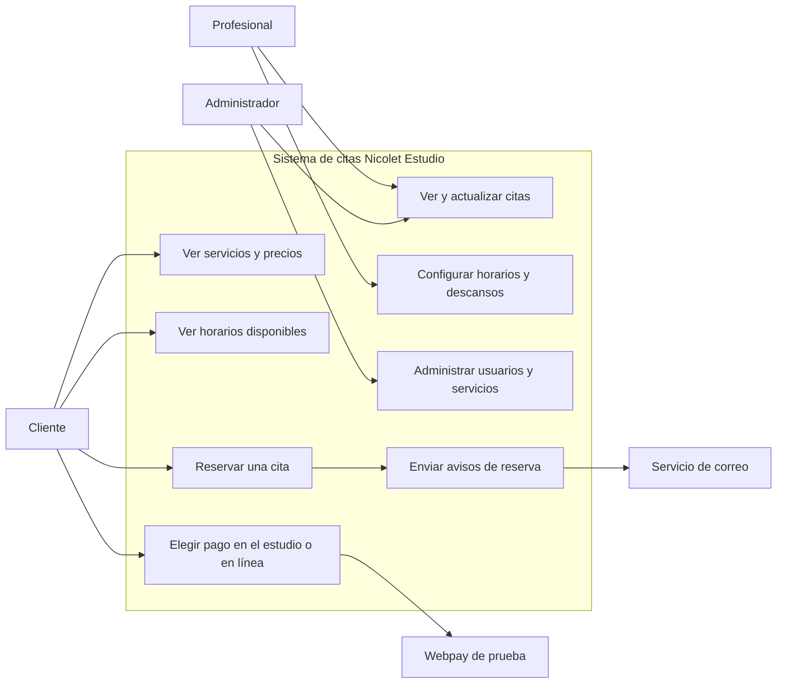
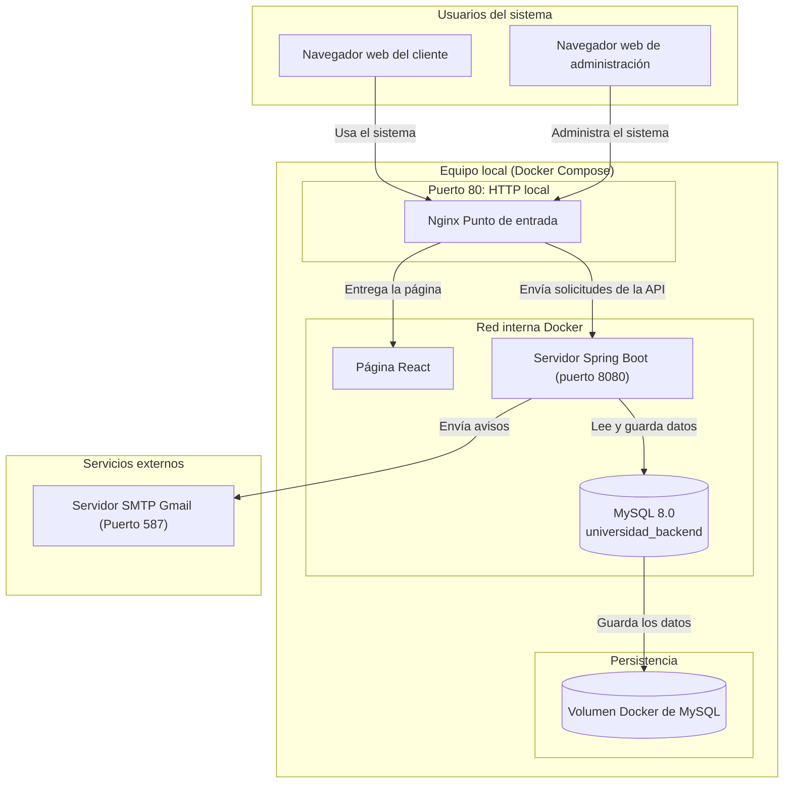
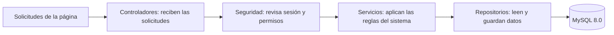
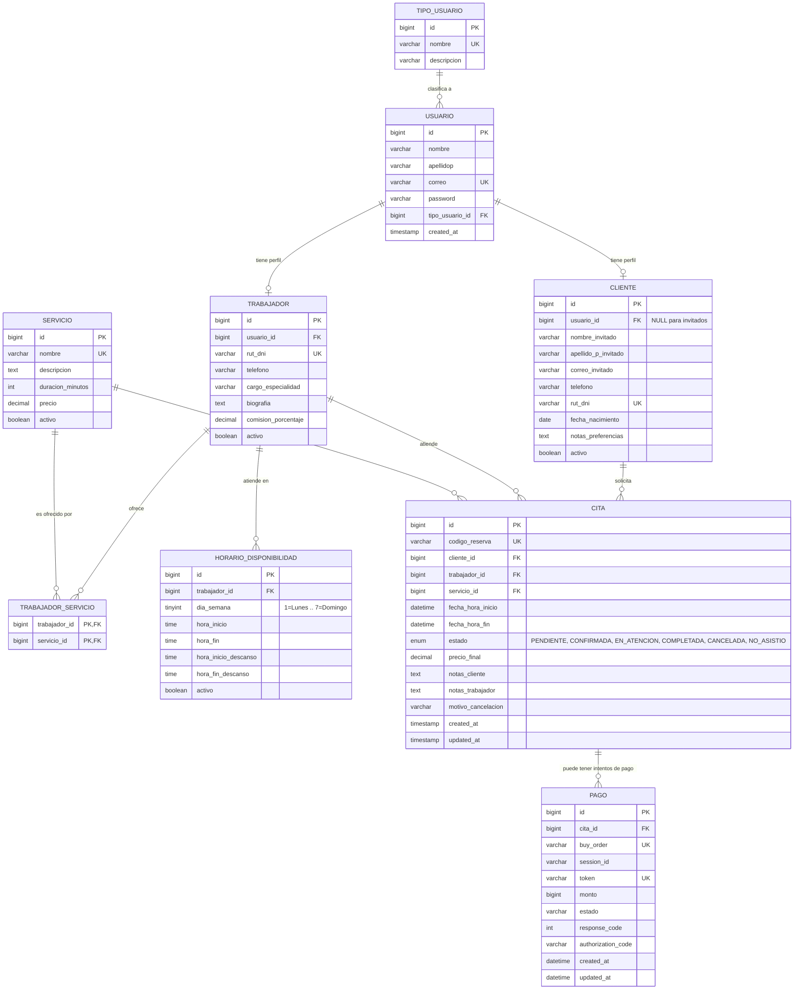

# Nicolet Estudio: Belleza a tu ritmo y sin barreras

Sistema web para reservar y administrar citas de un salón de belleza. Tiene una página web hecha con React, un servidor hecho con Spring Boot y una base de datos MySQL. Nginx conecta la página con el servidor cuando se usa Docker Compose.

---

## Tabla de Contenidos

1. [Descripción del Proyecto](#descripción-del-proyecto)
2. [Casos de Uso](#casos-de-uso)
3. [Estructura del Repositorio](#estructura-del-repositorio)
4. [Tecnologías Utilizadas](#tecnologías-utilizadas)
5. [Arquitectura del Sistema](#arquitectura-del-sistema)
   - [Tipo de Arquitectura](#tipo-de-arquitectura)
   - [Mapa de Arquitectura](#mapa-de-arquitectura)
   - [Capas del Servidor](#capas-del-servidor)
6. [Base de Datos](#base-de-datos)
   - [Tipo de Base de Datos](#tipo-de-base-de-datos)
   - [Mapa Entidad-Relación (Diagrama ER)](#mapa-entidad-relación-diagrama-er)
7. [Inicio en Local](#inicio-en-local)
   - [Inicio Rápido en Linux](#inicio-rápido-en-linux)
   - [Ejecución Manual por Componentes](#ejecución-manual-por-componentes)
   - [Iniciar todo con Docker Compose](#iniciar-todo-con-docker-compose)
8. [API y Documentación](#api-y-documentación)
   - [Swagger UI](#swagger-ui)
   - [Contratos y Reglas de Negocio](#contratos-y-reglas-de-negocio)
   - [Pagos con Webpay Plus](#pagos-con-webpay-plus)
9. [Seguridad y Pruebas](#seguridad-y-pruebas)
   - [Medidas de Seguridad](#medidas-de-seguridad)
   - [Pruebas Automatizadas](#pruebas-automatizadas)

---

## Descripción del Proyecto

Nicolet Estudio permite reservar y organizar servicios de belleza. Cada usuario tiene tareas distintas:

- **Clientes:** revisan los servicios y horarios disponibles, y reservan una cita. Pueden registrarse o reservar como invitados.
- **Profesionales:** revisan sus citas y configuran sus horarios de trabajo y descanso.
- **Administradores:** administran usuarios, servicios, precios y citas.

El sistema envía correos sobre las reservas y evita que dos clientes reserven el mismo horario a la vez.

---

## Casos de Uso

Este diagrama muestra las acciones principales de cada tipo de usuario:



### Ejemplo: reservar una cita

1. El cliente elige un servicio, un profesional y un horario disponible.
2. El sistema confirma que el horario siga libre y guarda la cita.
3. El cliente elige pagar en el estudio o continuar al pago de prueba en Webpay.
4. El sistema envía los avisos correspondientes por correo.

---

## Estructura del Repositorio

| Ruta | Contenido |
|---|---|
| `src/main/java/` | Código del servidor: solicitudes, reglas, datos y seguridad |
| `src/main/resources/` | Configuración del servidor y plantillas de correo |
| `src/test/` | Pruebas automatizadas del backend |
| `frontend/src/` | Página web y sus pruebas |
| `db/init.sql` | Tablas y servicios iniciales de MySQL |
| `scripts/` | Scripts auxiliares del proyecto |
| `docker-compose.yml` | MySQL local y phpMyAdmin opcional |
| `docker-compose.prod.yml` | Variante de Docker Compose con frontend, API y MySQL |
| `.env.example` | Plantilla de configuración para desarrollo local |

---

## Tecnologías Utilizadas

| Capa / Área | Tecnología | Versión / Detalle |
|---|---|---|
| **Página web** | React | 18 (interfaz del sistema) |
| | Vite | 6.x (inicia y prepara la página web) |
| | Vitest & Testing Library | Pruebas de la página web |
| **Backend** | Java | 17 LTS |
| | Spring Boot | 3.2.5 |
| | Spring Security | 6.x (inicio de sesión y control de permisos) |
| | Spring Data JPA / Hibernate | Conexión entre el código y MySQL |
| | Spring Boot Starter Mail | Envío de correos |
| | Springdoc OpenAPI | Documentación de la API con Swagger |
| | JUnit 5 & Mockito | Pruebas del servidor |
| **Base de Datos** | MySQL | 8.0 (Motor InnoDB, codificación `utf8mb4_unicode_ci`) |
| **Pagos** | Webpay Plus (Transbank) | Ambiente de integración por defecto |
| **Ejecución local** | Docker & Docker Compose | Inician el sistema en contenedores |
| | Nginx | 1.25+ (sirve la página y conecta con el servidor) |

---

## Arquitectura del Sistema

### Tipo de Arquitectura

El proyecto usa una arquitectura **cliente-servidor**: la página web y el servidor son partes separadas que se comunican por una API. El servidor se organiza en capas para mantener cada tarea en su lugar.

1. **Página web:** React muestra las pantallas en el navegador.
2. **Servidor:** Spring Boot recibe las solicitudes, aplica las reglas del sistema y devuelve respuestas a la página.
3. **Nginx:** En Docker Compose, entrega la página web y dirige las solicitudes de la API al servidor.

### Mapa de Arquitectura



### Capas del Servidor

El servidor divide el trabajo en partes. Cada una cumple una tarea:



1. **Controladores (`controller`):** reciben las solicitudes de la página y envían las respuestas.
2. **Seguridad (`security`):** revisa la sesión, el rol y los intentos de inicio de sesión.
3. **Servicios (`service`):** aplican las reglas, por ejemplo, comprobar si un horario está libre.
4. **Repositorios (`repository`):** leen y guardan información en la base de datos.
5. **Modelos (`model`):** representan los datos guardados, como clientes, profesionales y citas.

La mayoría de las solicitudes pasan de los controladores a los servicios y luego a la base de datos. Algunos flujos de inicio de sesión y correo acceden directamente a los datos para resolver tareas puntuales.

---

## Base de Datos

### Tipo de Base de Datos

- **Base de datos:** MySQL 8.0. Guarda la información en tablas relacionadas.
- **Nombre de la base de datos:** `universidad_backend`.
- **Modelo:** relacional. Las tablas se conectan entre sí con identificadores.
- **Tablas principales:** usuarios, clientes, profesionales, servicios, horarios, citas y pagos.
- **Almacenamiento:** InnoDB, con soporte para relaciones y transacciones.
- **Texto:** `utf8mb4`, que permite guardar tildes y otros caracteres.

### Mapa Entidad-Relación (Diagrama ER)



---

## Inicio en Local

### Qué necesitas

- Git para descargar el proyecto.
- Java 17 o superior y Node.js/npm compatibles con [`frontend/.nvmrc`](frontend/.nvmrc) si inicias cada parte por separado.
- Docker Compose para iniciar MySQL o todo el sistema.
- Puertos `3306`, `8080`, `5173` y, para Docker Compose completo, `80` libres.

Si necesitas cambiar la configuración local, copia `.env.example` como `.env`. No publiques ese archivo.

### Inicio rápido en Linux

Desde la carpeta principal del proyecto, ejecuta:

```bash
chmod +x iniciar.sh
./iniciar.sh
```

El script inicia MySQL, el servidor y la página web. Usa `./iniciar.sh --ayuda` para ver otras opciones. Necesitas Java, Node.js/npm, Docker Compose y las herramientas `curl`, `ss`, `setsid` y `timeout`.

---

### Ejecución Manual por Componentes

También puedes iniciar cada parte por separado, en una terminal distinta:

#### 1. Iniciar MySQL
```bash
docker compose up -d mysql_usuario
```

#### 2. Iniciar el servidor
En Windows (PowerShell), genera una clave local para las sesiones y ejecuta:
```powershell
$bytes = New-Object byte[] 48
$rng = [Security.Cryptography.RandomNumberGenerator]::Create()
$rng.GetBytes($bytes)
$env:JWT_SECRET = [Convert]::ToBase64String($bytes)
$env:DB_HOST = "127.0.0.1"
$env:DB_USERNAME = "desarrollador"
$env:DB_PASSWORD = "password_seguro_123"
.\mvnw.cmd spring-boot:run
```

En Linux / macOS (Bash):
```bash
export JWT_SECRET="$(openssl rand -base64 48)"
export DB_HOST="127.0.0.1"
export DB_USERNAME="desarrollador"
export DB_PASSWORD="password_seguro_123"
./mvnw spring-boot:run
```

El servidor quedará disponible en `http://localhost:8080`. Puedes definir `APP_ADMIN_EMAIL` y `APP_ADMIN_PASSWORD` para crear la primera cuenta administradora. Si no defines una contraseña, el sistema genera una y la muestra al iniciar.

#### 3. Iniciar la página web
```bash
cd frontend
npm ci
npm run dev
```

La página web quedará disponible en `http://localhost:5173`. Sus solicitudes al servidor se envían automáticamente al puerto `8080`.

---

### Iniciar todo con Docker Compose

Para levantar frontend, API y base de datos juntos en contenedores:

```bash
docker compose -f docker-compose.prod.yml up -d --build
```

Abre `http://localhost` en el navegador (puerto 80 servido por Nginx).

Comandos útiles para revisar el estado y los registros:

```bash
docker compose -f docker-compose.prod.yml ps
docker compose -f docker-compose.prod.yml logs -f backend
docker compose -f docker-compose.prod.yml logs -f frontend
```

Para detener los contenedores sin borrar la base de datos: `docker compose -f docker-compose.prod.yml down`. Los datos de MySQL se guardan en un volumen Docker.

---

## API y Documentación

### Swagger UI

Cuando el servidor esté iniciado, puedes abrir la documentación de la API aquí:
- **Swagger UI:** `http://localhost:8080/doc/swagger-ui.html`.
- **Datos de la API (JSON):** `http://localhost:8080/v3/api-docs`
- **Dirección base de la API:** `/api/v2/nicolet`

### Reglas de las citas

- Las fechas y horas usan la zona de Chile (`America/Santiago`).
- Una cita puede pasar por estos estados:
  - `PENDIENTE` $\rightarrow$ `CONFIRMADA` o `CANCELADA`.
  - `CONFIRMADA` $\rightarrow$ `EN_ATENCION`, `COMPLETADA`, `CANCELADA` o `NO_ASISTIO`.
  - `EN_ATENCION` $\rightarrow$ `COMPLETADA` o `CANCELADA`.
  - Los estados `COMPLETADA`, `CANCELADA` y `NO_ASISTIO` son terminales.
- Si algo falla, la API devuelve un mensaje que describe el problema.
- Los intentos repetidos de inicio de sesión y de registro tienen límites para reducir el uso indebido.

### Pagos con Webpay Plus

Al reservar, el cliente puede pagar en el estudio o en línea con Webpay Plus de Transbank. Webpay está configurado en modo de prueba: no se cobra dinero real.

1. Al elegir pago en línea, el sistema guarda la cita y mantiene el horario reservado por hasta 15 minutos.
2. El cliente completa el pago de prueba en la página de Webpay.
3. Webpay informa el resultado. Si el pago se aprueba, la cita queda pagada; si se rechaza o vence, se cancela y se libera el horario.

- Para probar un pago, usa la tarjeta VISA `4051 8856 0044 6623`, CVV `123` y una fecha futura. En el banco de prueba usa RUT `11.111.111-1` y clave `123`.
- Si el cliente paga en el estudio, se guarda la cita y se envían los avisos por correo.
- El servidor calcula el monto y confirma el pago con Webpay antes de marcar la cita como pagada.

---

## Seguridad y Pruebas

### Medidas de Seguridad

- **Inicio de sesión:** el servidor entrega un token JWT y lo revisa antes de permitir el acceso a las funciones protegidas.
- **Contraseñas:** se guarda una versión protegida de cada contraseña, no la contraseña original.
- **Permisos:** cada persona puede usar solo las funciones permitidas para su rol.
- **Intentos de acceso:** después de 5 intentos fallidos, se bloquea el acceso durante 15 minutos. Desde una misma IP se permiten hasta 10 registros por hora.
- **Datos recibidos:** el servidor revisa que la información enviada tenga el formato esperado.
- **Pagos:** el servidor calcula el monto y verifica el resultado con Webpay.

### Pruebas Automatizadas

Hay **69 pruebas automáticas de seguridad** en el servidor, agrupadas en **10 archivos** dentro de `src/test/java/cl/nicolet/backend/security/`. Revisan el inicio de sesión, los permisos, los límites de intentos, los datos recibidos y otros casos de seguridad. Este número solo cuenta esa carpeta; hay más pruebas en otras partes del proyecto.

Las pruebas del servidor usan JUnit y H2, una base de datos temporal para pruebas. Las pruebas de la página web usan Vitest y Testing Library.

Para correr todas las pruebas del servidor:

```bash
# Linux / macOS
./mvnw -B -ntp clean test

# Windows
.\mvnw.cmd -B -ntp clean test
```

Para correr las pruebas y preparar la página web:

```bash
cd frontend
npm test
npm run build
```

---

En Linux o macOS, para ejecutar solo las pruebas de seguridad:

```bash
./mvnw -Dtest=JwtUtilsTest,JwtIdentityIntegrationTest,LoginSecurityIntegrationTest,AuthorizationIntegrationTest,RegistrationIntegrationTest,RateLimitProxyIntegrationTest,ClientIpResolverTest,ValidacionApiIntegrationTest,RetiroDeRolIntegrationTest,QaStressAndSecurityIntegrationTest test
```

## Licencia y Créditos

Proyecto desarrollado para **Nicolet Estudio**.
